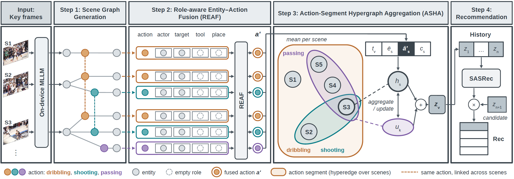

# ViewingContextPipeline

짧은 영상의 키프레임에서 **온디바이스 멀티모달 LLM으로 장면 그래프를 추출**하고, 이를 시퀀셜 추천(SASRec)의 영상 표현으로 쓰는 연구용 파이프라인입니다. MicroLens-100K와 M³L-10M 데이터셋을 지원합니다.



그림의 각 단계와 실행 명령은 다음과 같이 대응합니다.

| 그림 | 하는 일 | 명령 |
| --- | --- | --- |
| Input | 영상을 30초 창으로 나누고 창마다 키프레임 추출 | `python -m preparation …` |
| Step 1 | 온디바이스 VLM(Qwen3-VL 2B/4B/8B)으로 장면별 Context·Entities·Actions 그래프 생성 | `python -m extraction …` |
| Step 2–3 | BGE로 텍스트 특징을 고정하고, REAF(역할 결합)·ASHA(행동 구간 Hypergraph) 모듈로 영상 벡터 구성 | `python -m validation embed-representations`, `prepare-module` |
| Step 4 | 영상 벡터를 SASRec으로 학습·평가하고 실험 간 통계 비교 | `python -m validation run-recommendation`, `run-diagnosis` |

## 목차

- [요구 사항](#요구-사항)
- [설치](#설치)
- [환경 설정](#환경-설정)
- [실행](#실행)
- [결과 확인과 재실행](#결과-확인과-재실행)
- [실험 구성](#실험-구성)
- [테스트와 상세 문서](#테스트와-상세-문서)

## 요구 사항

| 항목 | Main 실험 (온디바이스) | 추가 실험 (Gemini 포함) |
| --- | --- | --- |
| OS | Linux | Linux |
| Python | 3.11 이상 (3.12에서 확인) | 같음 |
| GPU | 장면 추출에 CUDA GPU 필수. 추천 학습은 CPU에서도 실행 가능 | 같음. Gemini 추출만 할 때는 GPU 불필요 |
| 시스템 도구 | `ffmpeg`, `ffprobe` | 같음 |
| 모델 가중치 | Qwen3-VL Instruct(2B/4B/8B 중 사용할 것), `bge-large-en-v1.5` | Main + Vertex AI의 Gemini 접근 권한 |

## 설치

conda 환경을 만들고 `ffmpeg`를 설치합니다.

```bash
conda create -n vc python=3.12 -y
conda activate vc
conda install -c conda-forge ffmpeg -y
```

저장소를 받고 의존성과 패키지를 설치합니다. 의존성은 실험 범위에 따라 나뉩니다.

| 파일 | 범위 |
| --- | --- |
| [requirements-main.txt](requirements-main.txt) | Main 실험. 전처리, Qwen3-VL 추출(vLLM), BGE 임베딩, 추천 학습·진단 |
| [requirements-extra.txt](requirements-extra.txt) | 추가 실험. Main + Gemini(`google-genai`) |
| [requirements-dev.txt](requirements-dev.txt) | Main + 테스트·lint(`pytest`, `ruff`) |

```bash
git clone <repo-url> ViewingContextPipeline
cd ViewingContextPipeline
pip install -r requirements-main.txt
pip install -e .
```

Gemini 추출까지 쓰려면 Main 대신 추가 실험 의존성을 설치합니다.

```bash
pip install -r requirements-extra.txt
```

- pip가 드라이버와 맞지 않는 CUDA 빌드의 `torch`를 고르면, [PyTorch 설치 안내](https://pytorch.org/get-started/locally/)에 따라 `torch`를 먼저 설치한 뒤 위 명령을 실행합니다.
- 확인한 조합은 torch 2.13.0+cu130, transformers 5.19.0, vllm 0.32.0입니다.

## 환경 설정

모든 명령은 저장소 루트에서 실행합니다. `config.yaml`의 상대 경로도 저장소 루트를 기준으로 합니다.

### 1. 모델 가중치 받기

코드는 로컬 경로에서만 가중치를 읽고 자동으로 내려받지 않습니다. 필요한 모델을 먼저 받아 둡니다.

```bash
hf download Qwen/Qwen3-VL-2B-Instruct --local-dir /path/to/models/Qwen3-VL-2B-Instruct
hf download Qwen/Qwen3-VL-4B-Instruct --local-dir /path/to/models/Qwen3-VL-4B-Instruct
hf download Qwen/Qwen3-VL-8B-Instruct --local-dir /path/to/models/Qwen3-VL-8B-Instruct
hf download BAAI/bge-large-en-v1.5 --local-dir /path/to/models/bge-large-en-v1.5
```

Qwen은 실제로 쓰는 크기만 받으면 됩니다. BGE는 임베딩 단계에서 항상 필요합니다.

### 2. 데이터 배치

**MicroLens-100K**는 다음 파일이 필요합니다.

```text
MicroLens-100k_pairs.csv        # user,item,timestamp(ms)
MicroLens-100k_title_en.csv     # item,title
MicroLens-50k_titles.csv        # (선택) 빈 제목 보완
MicroLens-100k_videos/{item_id}.mp4
```

**M³L-10M**은 `root` 아래 다음 구조를 둡니다.

```text
<root>/metadata/ratings.dat
<root>/metadata/movies.dat
<root>/metadata/id_mmrec_to_grouplens.tsv
<root>/videos/{original_GroupLens_movieId}.mp4
```

쓰지 않는 데이터셋의 파일은 없어도 됩니다. 입력 형식과 제외 규칙은 [데이터 입력](docs/runtime.md#데이터-입력과-cohort)에 정리되어 있습니다.

### 3. `config.yaml` 수정

[config.yaml](config.yaml)에서 경로를 내 환경에 맞게 바꿉니다. 경로가 placeholder로 비워져 있고 항목마다 설명 주석이 달린 [config.example.yaml](config.example.yaml)을 복사해 시작해도 됩니다.

```bash
cp config.example.yaml config.yaml
```

주로 바꿀 항목은 다음과 같습니다.

```yaml
artifacts_root: artifacts            # 모든 산출물이 저장되는 위치
datasets:
  microlens_100k:
    data:
      pairs_csv: /path/to/MicroLens-100k_pairs.csv
      videos_dir: /path/to/MicroLens-100k_videos
      titles_csv: /path/to/MicroLens-100k_title_en.csv
      titles_supplement_csv: /path/to/MicroLens-50k_titles.csv
  m3l_10m:
    data:
      root: /path/to/m3l-10m
models:
  qwen3vl_2b: /path/to/models/Qwen3-VL-2B-Instruct
  bge: /path/to/models/bge-large-en-v1.5
```

- `models`, `extraction.graph`, `extraction.description`에는 실제로 쓰는 모델만 남겨도 됩니다. 빠진 모델로 추출하면 그 단계에서 바로 오류가 납니다.
- 그 밖의 값은 기본값으로 실행할 수 있습니다.
  - `extraction.visual_evidence`: 시간 창 길이, 키프레임 수, 해상도
  - `extraction.qwen`: vLLM 엔진 설정
  - `validation.model`, `validation.evaluation`: 학습 크기, seed, cutoff, bootstrap 수
- 모르는 키를 추가해도 거부하지 않습니다. `validation` 아래 값은 [기본값](src/validation/config.py)이 있어 생략할 수 있습니다.

### 4. 추천 실험 목록 만들기

`rec_experiments_config.yaml`은 Run마다 바꿔 쓰는 파일이라 git에서 제외되어 있습니다. 예시를 복사해서 씁니다.

```bash
cp rec_experiments_config.example.yaml rec_experiments_config.yaml
```

### 5. (추가 실험) Gemini 설정

Gemini는 Vertex AI를 ADC(Application Default Credentials)로 호출합니다. API 키는 쓰지 않습니다.

```bash
gcloud auth application-default login
```

`config.yaml`의 `models.gemini`에 본인 프로젝트를 지정합니다.

```yaml
models:
  gemini:
    project_id: <your-gcp-project>
    location: global
    model_id: gemini-3.8-flash
    temperature: 0.0
    thinking_level: low
    media_resolution: MEDIA_RESOLUTION_LOW
extraction:
  gemini:
    threads: 128                     # 동시 요청 수
```

## 실행

```bash
RUN_ID=exp001
DATASET=microlens_100k   # 또는 m3l_10m
```

각 명령은 독립 단계이며, 앞 단계가 끝난 뒤 다음 단계를 실행합니다. 사용할 GPU는 `CUDA_VISIBLE_DEVICES`로 고릅니다.

아래 단계를 한 번에 실행하는 스크립트 예시도 있습니다. 복사본 `run_script.sh`는 git에서 제외됩니다.

```bash
cp run_script.example.sh run_script.sh   # RUN_ID, DATASET, MODEL 등을 수정
bash run_script.sh
```

### 1. 전처리 (Input)

```bash
python -m preparation prepare-cohort --run-id "$RUN_ID" --dataset "$DATASET"
python -m preparation prepare-input-data --run-id "$RUN_ID" --dataset "$DATASET"
```

- `prepare-cohort`는 상호작용·제목·영상 목록을 읽어 데이터셋별 공유 cohort를 만듭니다.
- `prepare-input-data`는 키프레임을 추출합니다. 제목만 쓰는 `metadata` 실험만 돌린다면 이 단계와 장면 추출은 필요 없습니다.

### 2. 장면 추출 (Step 1)

실험 목록에서 쓰는 source만 추출합니다. source 이름은 `graph_<model>` 또는 `desc_<model>`입니다.

```bash
# Main: 온디바이스 Qwen3-VL
python -m extraction extract-graph-scenes --run-id "$RUN_ID" --dataset "$DATASET" \
  --model qwen3vl_2b --schema prompts/scene_graph_v9_core.md
python -m extraction extract-description-scenes --run-id "$RUN_ID" --dataset "$DATASET" \
  --model qwen3vl_2b --schema prompts/scene_description_v3.md

# 추가 실험: Gemini
python -m extraction extract-graph-scenes --run-id "$RUN_ID" --dataset "$DATASET" \
  --model gemini --schema prompts/scene_graph_v9_core.md
```

- `--model`은 `qwen3vl_2b`, `qwen3vl_4b`, `qwen3vl_8b`, `gemini` 중 하나입니다.
- `--schema`는 [prompts/](prompts/)의 프롬프트 파일입니다.
  - Graph: `scene_graph_v8.md`, `v8_2`, `v9_core`, `v9_extended`, `v10_core`, `v10_extended`
  - Description: `scene_description_v3.md`
- 로컬 Qwen에서만 쓰는 생성 옵션이 있습니다: `--presence-penalty`, `--repetition-penalty`, `--stop-repeated-lines`. 자세한 내용은 [장면 추출](docs/scene_extraction.md#qwen-생성-정책과-옵션)을 참고하세요.
- 결과는 `artifacts/runs/<RUN_ID>/<dataset>/extraction/<source>/`에 저장됩니다.

### 3. 특징과 모듈 준비 (Step 2–3)

```bash
python -m validation embed-representations --run-id "$RUN_ID" --dataset "$DATASET"
python -m validation prepare-module --run-id "$RUN_ID" --dataset "$DATASET"
```

- `embed-representations`는 실험 목록이 쓰는 source마다 BGE 특징을 한 번 계산합니다.
- `prepare-module`은 `ASHA`를 쓰는 실험의 행동 구간 파일을 만듭니다. 해당 실험이 없으면 아무것도 하지 않습니다.

### 4. 추천 학습과 진단 (Step 4)

```bash
python -m validation run-recommendation --run-id "$RUN_ID" --dataset "$DATASET" --workers-per-gpu 1
python -m validation run-diagnosis --run-id "$RUN_ID" --dataset "$DATASET"
```

- 실험 × seed 조합마다 SASRec을 따로 학습합니다.
  - `--workers-per-gpu`는 GPU 하나에서 동시에 학습할 조합 수입니다.
  - GPU가 없으면 1로 두고 CPU에서 학습합니다.
- `run-diagnosis`는 test 지표를 모으고, 모든 실험 쌍에 대해 paired bootstrap(Bonferroni 보정)을 계산합니다.
- 다른 Run과 비교하려면 `--compare-run-id <다른 RUN_ID>`를 붙입니다. 두 Run의 cohort 이벤트와 분할이 같아야 합니다.

## 결과 확인과 재실행

`<run-root>`는 `artifacts/runs/<RUN_ID>/<dataset>/`이고, `<experiment-set>`은 실험 label을 순서대로 밑줄로 이은 이름입니다.

| 내용 | 위치 |
| --- | --- |
| 진단 보고서 (사람이 읽는 표) | `<run-root>/reports/<experiment-set>/report.md` |
| 최종 지표·통계 (JSON) | `<run-root>/validation/diagnosis/<experiment-set>/diagnosis.json` |
| 조합별 checkpoint·학습 기록·이벤트별 지표 | `<run-root>/validation/recommendations/seed_<seed>/<label>/` |
| 장면 추출 결과 | `<run-root>/extraction/<source>/<content_id>.jsonl` |
| 분할과 고정 특징 | `<run-root>/validation/cohort/`, `<run-root>/validation/representations/<source>/` |

재실행 규칙은 단순합니다.

- 결과 파일이 있으면 완료로 보고 건너뜁니다.
  - 장면: 정상 장면
  - 특징: `manifest.json`
  - 추천: `complete.json`
- 설정·코드·프롬프트를 바꾼 뒤 다시 만들려면 해당 단계를 `--force`로 실행하거나 새 `RUN_ID`를 씁니다.
- 장면 추출에서는 누락·실패·경고 장면만 다시 생성합니다.
- 다른 Run에서 같은 조건으로 만든 특징과 학습 결과가 있으면 `artifacts/shared_cache/`에서 복사해 재사용합니다.

자세한 규칙은 [실행·저장 규칙](docs/runtime.md#재실행과-캐시)에 있습니다.

## 실험 구성

`rec_experiments_config.yaml`의 각 항목이 추천 실험 하나입니다. validation 명령은 이 파일의 실험을 모두 목록 순서대로 처리합니다.

```yaml
experiments:
  - label: base                # 결과 디렉터리 이름
    source: metadata           # 제목만 사용
  - label: graph
    source: graph_qwen3vl_2b   # 추출한 source
  - label: graph+REAF+ASHA
    source: graph_qwen3vl_2b
    modules: [REAF, ASHA]
```

| 필드 | 값 |
| --- | --- |
| `label` | 영문·숫자로 시작하고 영문·숫자·`_ + . -`만 사용. 대소문자 무시 중복 불가 |
| `source` | `metadata`, 또는 `graph_`·`desc_` 뒤에 `qwen3vl_2b`·`qwen3vl_4b`·`qwen3vl_8b`·`gemini` |
| `modules` | Graph source에서만 사용. `REAF`(역할 결합), `GNN_ATTN`(영상 내 장면 attention), `ASHA`(행동 구간 Hypergraph). 여러 개 조합 가능 |
| `segments` | (선택, `ASHA` 필요) 구간 ablation: `action_bag`, `time_window`, `random` |
| `segments_seed` | (선택) `segments` 변형의 난수 seed. 기본 0 |

- 모든 실험은 제목 특징을 함께 씁니다.
- `metadata` 실험이 있으면 보고서의 상대 변화율 기준이 됩니다.
- 모듈은 목록 순서와 관계없이 REAF → Scene MLP → GNN_ATTN → ASHA → 영상 평균 순서로 적용합니다.
- 수식과 설계는 [인코더·모듈·학습·평가](docs/graph_training.md)에 있습니다.

## 테스트와 상세 문서

CPU에서 작은 가짜 데이터로 전처리부터 진단까지 실행하는 회귀 테스트입니다. GPU나 실제 모델은 쓰지 않습니다.

```bash
pip install -r requirements-dev.txt
CUDA_VISIBLE_DEVICES='' python -m pytest -q tests
```

| 문서 | 내용 |
| --- | --- |
| [장면 추출](docs/scene_extraction.md) | 장면 스키마, 출력 예시, 파싱 규칙, Qwen/Gemini 옵션 |
| [인코더·모듈·학습·평가](docs/graph_training.md) | 모델 수식, 결측 처리, 평가 규칙 |
| [실행·저장 규칙](docs/runtime.md) | 데이터 입력, 산출물 경로, 재실행과 캐시 |
| [프롬프트 변경 이력](prompts/update_note.md) | 프롬프트 버전별 변경 의도 |

논문 그림(`WWW2027/figures/`)은 `python docs/design/generate_hgvrec_figures.py`로 다시 만들 수 있습니다. 이 스크립트에는 `python-pptx`, `pymupdf`, LibreOffice가 추가로 필요합니다.
